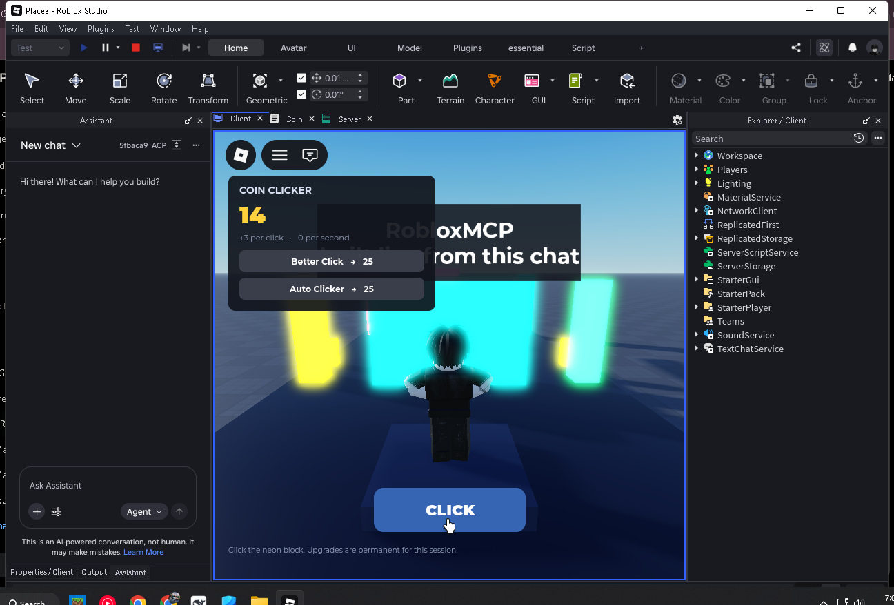

# RobloxMCP — MCP server + Studio plugin

Control a **live Roblox Studio session** from any MCP client (Claude Desktop, Claude Code, Cursor, Codex, DeepSeek Harness). Read the Explorer, create and edit instances, read and patch scripts, and undo everything — without leaving the chat.

Two halves, both in this folder:

```
MCP client (Claude / Cursor / Codex / DSH ...)
        │  JSON-RPC 2.0 over stdio
        ▼
roblox-mcp  (Node, zero runtime dependencies)
  ├── MCP server    initialize, tools/list, tools/call
  └── HTTP bridge   127.0.0.1:44755  (loopback only)
        ▲  long-poll for work + POST the result
        │
RobloxMCP plugin  (Luau, runs inside Studio)
  └── executes operations on the open place, one undo step per tool call
```

Studio plugins cannot listen on a socket, so the plugin polls the bridge. That is why the plugin must be connected *and* the server must be running; either side can be restarted independently.



## Requirements

- Roblox Studio (tested on 0.746)
- Node.js 20+ (tested on 26)
- No build step, no runtime npm packages

## Install

### 1. Start the server

```powershell
cd roblox-mcp
npm start                          # or: node bin/roblox-mcp.js
```

Keep it running. It prints the port it bound (44755 unless that port is busy):

```
[roblox-mcp] bridge listening on http://127.0.0.1:44755
```

### 2. Install the Studio plugin

Copy `plugin/RobloxMCP.rbxmx` into Studio's Plugins folder, then restart Studio (or use **Plugins → Plugins Folder** to open the folder):

| OS | Folder |
|---|---|
| Windows | `%LOCALAPPDATA%\Roblox\Plugins` |
| macOS | `~/Documents/Roblox/Plugins` |

`scripts/install-plugin.ps1` does this copy for you on Windows.

### 3. Connect

In Studio: **Plugins** tab → **RobloxMCP** → the panel opens and auto-connects if the server is running. If it shows "MCP server not running", start the server and press **Connect**. The port field must match the server's port.

### 4. Verify end to end

```powershell 
node scripts/smoke-studio.mjs      # 17 checks against the open place, cleans up after itself
node scripts/mcp-check.mjs         # speaks MCP stdio, lists tools, calls a few
```

## Connect an MCP client

`node bin/roblox-mcp.js --print-config` prints a ready snippet with absolute paths.

**Claude Desktop** — `%APPDATA%\Claude\claude_desktop_config.json`:

```json
{
  "mcpServers": {
    "roblox-studio": {
      "command": "node",
      "args": ["C:\\path\\to\\roblox-mcp\\bin\\roblox-mcp.js", "--port", "44755"]
    }
  }
}
```

**Claude Code**

```powershell
claude mcp add roblox-studio -- node "C:\path\to\roblox-mcp\bin\roblox-mcp.js"
```

**Cursor** — `.cursor/mcp.json` (same `mcpServers` shape as above).

**Codex CLI** — `~/.codex/config.toml`:

```toml
[mcp_servers.roblox-studio]
command = "node"
args = ["C:\\path\\to\\roblox-mcp\\bin\\roblox-mcp.js"]
```

**DeepSeek Harness** — the harness reaches MCP servers through `@deepseek-ai/dsh-mcp-client`. With that plugin available in your profile, add this to `%USERPROFILE%\.dsh\profiles\<profile>\cordis.patch.yml`:

```yaml
- id: mcp-roblox
  name: "@deepseek-ai/dsh-mcp-client"
  config:
    serverName: roblox
    transport: stdio
    command: node
    args: ["C:\\path\\to\\roblox-mcp\\bin\\roblox-mcp.js", "--port", "44755"]
    toolCallTimeoutMs: 60000
```

Tools then appear as `mcp__roblox__get_tree`, `mcp__roblox__set_properties`, … If the plugin is not installed yet, add it to the profile with `pnpm add @deepseek-ai/dsh-mcp-client` from the profile directory first.

## Tools

| Tool | What it does |
|---|---|
| `studio_status` | Is Studio attached, which place, port, round-trip ping |
| `get_tree` | Explorer hierarchy from a path (`depth`, `maxNodes`, optional properties) |
| `search_instances` | Find instances by name substring / class (incl. `*Script` wildcard) |
| `get_instance` | ClassName, parent, attributes, tagged property snapshot |
| `create_instance` | New instance with properties + attributes; returns its path |
| `set_properties` | Set properties/attributes; reports per-property errors |
| `delete_instance` | Destroy instance (undoable) |
| `clone_instance` | Deep clone, optionally reparented/renamed |
| `reparent_instance` | Move an instance (rejects cycles) |
| `get_script_source` | Full source of a Script/LocalScript/ModuleScript |
| `set_script_source` | Replace full source, keeps an open editor tab in sync |
| `edit_script` | Exact literal text replacement; fails if the text is missing, refuses ambiguous matches |
| `get_selection` | What the user has selected in Studio |
| `set_selection` | Select instances, optionally focus the camera |
| `insert_asset` | Insert a Roblox asset by id via InsertService |
| `history` | `undo` / `redo` / `waypoint` |
| `get_console_output` | Recent Studio Output lines |
| `run_selftest` | Probe Studio APIs the plugin depends on |

Every mutating tool call is wrapped in one `ChangeHistoryService` recording, so **one tool call = one Ctrl+Z**.

## Paths and values

Paths accept the forms you see in the Explorer and command bar:

```
Workspace.Model.Part
game.Workspace.Model.Part
game.Workspace["My Part"].Model
```

Property values are plain JSON where possible, tagged where Roblox needs types:

```jsonc
{
  "Size": { "__type": "Vector3", "x": 4, "y": 1, "z": 2 },
  "CFrame": { "__type": "CFrame", "components": [0,5,0, 1,0,0, 0,1,0, 0,0,1] },
  "Color": "#ff8800",                              // or {"__type":"Color3","r":1,"g":0.53,"b":0}
  "Material": "Neon",                              // or "Enum.Material.Neon"
  "AnchorPoint": { "__type": "Vector2", "x": 0, "y": 0 }
}
```

Supported on both directions: `Vector2/3`, `CFrame`, `Color3`, `BrickColor`, `UDim`, `UDim2`, `Rect`, `NumberRange`, `NumberSequence`, `ColorSequence`, `PhysicalProperties`, `Font`, `TweenInfo`, `Axes`, enums, and instance references (by path).

## Example: a clicker game

`examples/clicker/` is a complete, playable clicker built through the bridge and left in the place:

```powershell
node scripts/build-clicker.mjs     # (re)build it in the open place
```

It creates `Workspace.ClickerGame` (neon click wall, lamps, spawn), a server-authoritative
coin/upgrade system (`ServerScriptService.ClickerServer` + testable `ClickerLogic`),
three remotes, and a `StarterGui.ClickerGui` HUD with two upgrade tracks and a big `CLICK`
button. Press **Play** in Studio to play it. The math module is unit tested by
`test/clicker-logic.test.js`, so upgrade costs and affordability are verified without Studio.

## Security model

- The bridge binds `127.0.0.1` only and rejects non-loopback peers.
- Anything running as your user can reach it; pass `--token <secret>` for a shared secret the plugin must send (set the same token in the panel). The token is stored in Studio plugin settings, not in the place.
- The server cannot run arbitrary Luau: Studio plugins have no `loadstring`. That is why the surface is a fixed set of declarative operations instead of an `execute_code` tool. (Roblox's official Studio MCP can offer `run_code` because it is built into Studio itself.)
- Every change happens in the open place and lands in Studio's undo history.

## Troubleshooting

| Symptom | Fix |
|---|---|
| `studio_disconnected` | Server running? Plugin panel connected? Port fields matching? Press Connect again. |
| Plugin says "Can't reach server" | Start `npm start`. If it chose another port (44756…), type that port in the panel. |
| `studio_timeout` | A Studio modal dialog (save prompt, script analysis) blocks plugin threads. Close it and retry. |
| `protocolMismatch` in `studio_status` | Plugin and server are from different builds — rebuild with `npm run build:plugin` and reinstall. |
| `not_a_script` | `get_script_source` / `set_script_source` only work on Script, LocalScript, ModuleScript. |
| `invalid_parent` | Reparent would create a cycle (moving a parent into its own descendant). |
| Scripts edited externally look stale in Studio | The plugin updates open editor buffers through `ScriptEditorService`; close and reopen the script if Studio still shows old text. |
| Nothing works after a Studio update | `run_selftest` in the panel lists which Studio API the build no longer allows. |

## Development

```
bin/roblox-mcp.js        CLI entry
src/bridge.js            loopback HTTP bridge, queue, long-poll, auth
src/mcp.js               MCP JSON-RPC over stdio
src/tools.js             tool schemas + handlers
src/main.js              CLI args, wiring, shutdown
plugin/src/*.luau        Studio plugin (Api, Codec, Ops, Paths, init.server)
plugin/build.js          packs plugin/src into plugin/RobloxMCP.rbxmx
scripts/                 smoke-studio.mjs, mcp-check.mjs, install-plugin.ps1
test/                    node:test suites (bridge, MCP, end-to-end with a fake plugin, Luau compile)
```

```powershell
npm test                  # bridge + MCP + e2e + Luau syntax (needs devDependency @luau-rs/luau)
npm run build:plugin      # regenerate plugin/RobloxMCP.rbxmx
npm run smoke             # live Studio smoke test
node bin/roblox-mcp.js --http-only --keep-alive   # bridge only, drive it with curl /v1/rpc
```

### Saving changes

Double-click **`save.cmd`** in the repo root, type a short message, press Enter: it pulls any
website edits, commits everything, and pushes to GitHub. The plain-git equivalent is
`git add -A && git commit -m "..." && git push`.

`POST http://127.0.0.1:44755/v1/rpc` takes `{ "method": "getTree", "params": {...} }` and returns `{ "ok": true, "result": ... }` — handy for debugging without an MCP client.

## Limits

- One Studio session at a time (the most recent plugin connection wins).
- No playtest start/stop and no arbitrary code execution; those need APIs that only Studio's internal MCP exposes.
- `insert_asset` needs Studio network access and an asset you can load.
- The plugin must stay polling: while a tool runs, Studio's main thread is busy, so huge trees/property dumps are capped (`maxNodes`, `maxVisited`).

## License

MIT — see [LICENSE](LICENSE). The plugin model in `plugin/RobloxMCP.rbxmx` is generated from `plugin/src`; run `npm run build:plugin` after changing the Luau sources.
